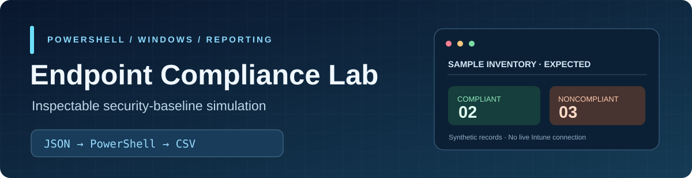

<div align="center">



# Enterprise Endpoint Compliance Lab

**Windows Endpoint Administration · PowerShell 7 · Security Baseline Reporting**

[](https://github.com/yamen-chaban/enterprise-endpoint-compliance-lab/actions/workflows/tests.yml)  

</div>

> **Important:** This project evaluates fictional device inventory. It does not connect to Microsoft Intune, scan real endpoints or demonstrate production deployment. The example counts were confirmed by the GitHub Actions smoke test on 23 November 2026 (see CI evidence below).

**Quick navigation:** [Run locally](#lokal-ausführen) · [Test script](tests/Test-EndpointComplianceReport.ps1) · [Architecture](docs/architecture.md) · [Troubleshooting](docs/troubleshooting.md) · [Learning journal](docs/projektjournal.md)

---
> **Portfolio-Projekt (Simulation)** · Windows Endpoint Administration · PowerShell · Reporting

## Ziel
Ein fiktives Unternehmen mit 50 Mitarbeitenden benötigt einen nachvollziehbaren Bericht über grundlegende Sicherheitsmerkmale verwalteter Windows-Geräte. Dieses Repository enthält eine **eigenständig erstellte PowerShell-Auswertung** für synthetische Testdaten. Es ist **keine reale Intune-Integration** und **kein Nachweis einer produktiven Bereitstellung**.

## Umgebung
- PowerShell 7 oder höher (`pwsh`)
- Keine Azure-/Intune-Lizenz erforderlich
- Keine Administratorrechte erforderlich
- Fiktive Inventardaten in `data/devices.sample.json`

## Umsetzung
Das Skript `scripts/Get-EndpointComplianceReport.ps1` bewertet für jedes Gerät diese **nur für das Demo definierte** Baseline:

| Prüfkriterium | Demo-Regel |
|---|---|
| Windows OS Build | mindestens `22631` (konfigurierbar) |
| BitLocker | aktiviert |
| Microsoft Defender | aktiviert |
| Firewall | aktiviert |

Das Ergebnis ist eine CSV-Datei mit `Compliant` oder `NonCompliant` und einer Begründung. **Diese Regeln sind Demonstrationsregeln, keine vollständige Microsoft Intune-Compliance-Richtlinie.**

## Lokal ausführen

```powershell
pwsh ./scripts/Get-EndpointComplianceReport.ps1 -InventoryPath ./data/devices.sample.json -ReportPath ./output/compliance-report.csv
```

Tests ausführen:

```powershell
pwsh ./tests/Test-EndpointComplianceReport.ps1
```

**Verifizierter CI-Nachweis (23.11.2026):** 5 synthetische Geräte, **2 compliant / 3 noncompliant**. Der Job `smoke-test` war erfolgreich und protokollierte `PASS: all smoke tests completed.` [Workflow-Lauf 45266467933](https://github.com/yamen-chaban/enterprise-endpoint-compliance-lab/actions/runs/45266467933) · [Projektjournal](docs/projektjournal.md). Der Nachweis gilt für den getesteten Commit; keine produktive Intune-Integration.

## Projektstruktur

```text
enterprise-endpoint-compliance-lab/
├── .github/workflows/tests.yml
├── data/devices.sample.json
├── docs/architecture.md
├── docs/troubleshooting.md
├── docs/projektjournal.md
├── scripts/Get-EndpointComplianceReport.ps1
├── tests/Test-EndpointComplianceReport.ps1
├── .gitignore
├── SECURITY.md
└── README.md
```

## Problem → Lösung → Ergebnis → Gelernt

- **Problem:** Ein IT-Support-Team muss auffällige Gerätekonfigurationen priorisieren.
- **Lösung:** Prüfroutinen und standardisierter CSV-Report statt manueller Einzelprüfung.
- **Ergebnis:** Reproduzierbare Auswertung der synthetischen Testdaten. Noch keine echte Geräteverwaltung.
- **Gelernt:** PowerShell-Objekte, JSON, Validierung, nachvollziehbare Abweichungsgründe, Tests und Dokumentation.

## Grenzen / Nächste Version

1. Demodaten erweitern und mehr Randfälle testen.
2. Eine lokal *autorisierte* Testumgebung erstellen und Ergebnisse vergleichen.
3. Erst mit ausdrücklicher Berechtigung und geeignetem Test-Tenant die Verbindung zu Microsoft Intune / Graph untersuchen.
4. Screenshots nur von eigenen Demo-Daten und eigener Umgebung verwenden.

## Für Bewerbungen
**Relevanz:** Junior IT-Systemadministrator, 2nd-Level-Support, Endpoint/Modern Workplace Administration.

**Kurzbeschreibung für das Vorstellungsgespräch:**
> Ich habe ein PowerShell-Tool entwickelt, das synthetische Windows-Geräteinventardaten anhand einer konfigurierbaren Sicherheits-Baseline auswertet, Abweichungen erklärt und einen CSV-Report erstellt. Die Tests sind im Repository dokumentiert. Eine produktive Intune-Integration ist ausdrücklich nicht Teil dieser Version.

## Datenschutz / Rechte
Keine Passwörter, Tokens, echte Geräteinventare, Kundendaten, Kursmaterialien, Screenshots aus dem Unterricht oder alfatraining-spezifischen Dateien veröffentlichen. Vor dem Einsatz eines Schulungsgeräts oder einer Schulungsumgebung die Nutzungsregeln beachten.

## Referenzen
- [Microsoft Learn – Intune Compliance Policies](https://learn.microsoft.com/en-us/intune/device-security/compliance/overview)
- [GitHub – Best Practices for Repositories](https://docs.github.com/en/repositories/creating-and-managing-repositories/best-practices-for-repositories)

**Status:** Trainingssimulation mit dokumentiertem, erfolgreichem CI-Smoke-Test. Weitere Randfalltests und reale autorisierte Lab-Umgebungen bleiben nächste Schritte.

## Täglicher Lern- und Entwicklungsplan (26.10.–20.11.2026)

Der [tägliche 20-Tage-Portfolio-Plan](docs/daily-course-to-github-roadmap.md) verbindet angekündigte Weiterbildungsthemen mit **eigenen, unabhängigen** GitHub-Übungen. Offene Aufgaben sind in den [GitHub Issues](../../issues) erfasst. Alle Einträge sind Vorschläge und erst nach praktischer Umsetzung erledigt.
