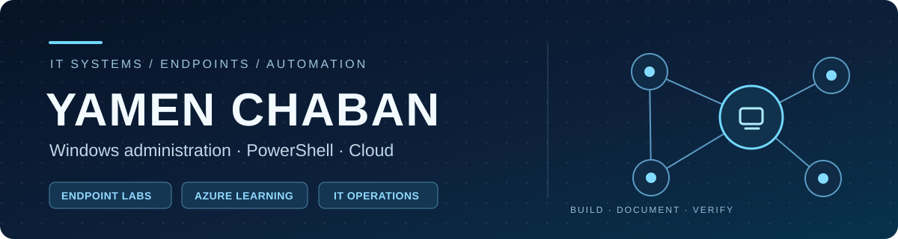
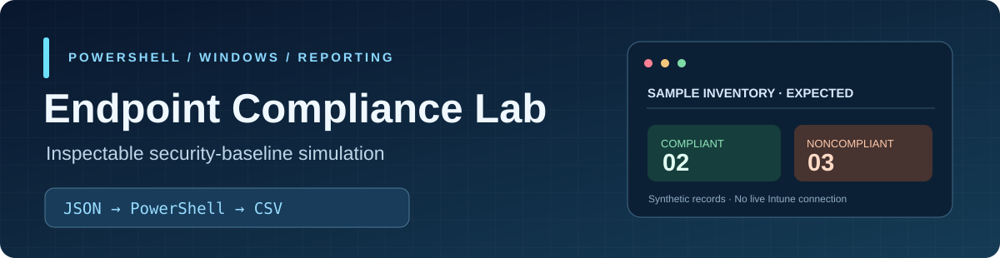

# Hello, I’m Yamen 👋

**IT Support · Systems Administration · Windows Endpoint Management · Cloud Fundamentals**

 

## About me

I’m an IT professional with experience in technical support and software development and an **M.Sc. in Informatics**. My current focus is **Windows endpoint administration, Microsoft Intune concepts, PowerShell automation, Microsoft 365, networking, and Azure fundamentals**.

This profile is a practical portfolio: reproducible labs, documented decisions, honest constraints, and code you can inspect. My public work deliberately separates **tested evidence**, **sample data**, and **future plans**.

## Technical focus

| Domain | Practical interests |
| --- | --- |
| **Windows & Endpoint Administration** | Configuration, baselines, device troubleshooting, security fundamentals |
| **PowerShell** | Inventory validation, reporting, automation |
| **Microsoft Intune & Microsoft 365** | Role-based access, endpoint-management workflows, lab documentation |
| **Azure & Networking** | Azure administration fundamentals, network troubleshooting, access controls |
| **Engineering workflow** | Git, repeatable tests, clear READMEs and privacy-aware demo data |

### Tools and technologies

     

> Technologies represent a combination of professional background and current learning areas, not a claim of expert certification in every product.

## Featured project

### [Enterprise Endpoint Compliance Lab](https://github.com/yamen-chaban/enterprise-endpoint-compliance-lab)

**PowerShell 7 · JSON validation · Windows security baseline · CSV reporting · GitHub Actions**

A reproducible PowerShell project that evaluates **synthetic** Windows device inventory against a configurable demonstration baseline: OS build, BitLocker, Microsoft Defender and Firewall. It produces a CSV report with specific findings for IT support.

**Inspect the work:** [script](https://github.com/yamen-chaban/enterprise-endpoint-compliance-lab/blob/main/scripts/Get-EndpointComplianceReport.ps1) · [smoke test](https://github.com/yamen-chaban/enterprise-endpoint-compliance-lab/blob/main/tests/Test-EndpointComplianceReport.ps1) · [architecture](https://github.com/yamen-chaban/enterprise-endpoint-compliance-lab/blob/main/docs/architecture.md) · [test workflow](https://github.com/yamen-chaban/enterprise-endpoint-compliance-lab/actions/workflows/tests.yml)

> **Project boundary:** This is a training simulation, **not** a production deployment or live Intune integration. Review the GitHub Actions run history for verified CI status.

## How I work

1. Define the actual IT problem and the permitted test environment.
2. Build a small, inspectable solution or procedure.
3. Test, document outcomes and separate observed results from assumptions.
4. Explain limitations, security considerations and next steps.
5. Publish only synthetic or thoroughly sanitized evidence.

## Portfolio roadmap

- Publish a **sanitized Intune RBAC case study** when evidence is ready for public release.
- Expand **PowerShell inventory/reporting** with additional edge-case tests.
- Add reproducible **Azure and networking** labs.

Roadmap items are plans, **not** completed or publicly accessible projects.

---

<b>Build · Document · Verify</b> Practical IT portfolio | Germany

